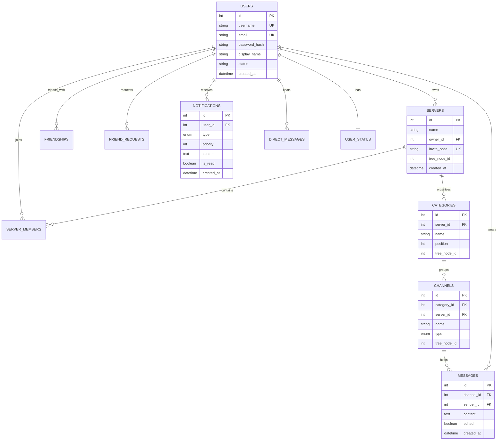

# ConnectHub Database Documentation

## 1. Overview
The **ConnectHub** platform uses **MySQL 8.4 Community Server** with the InnoDB storage engine for ACID compliance, transactional integrity, and relational foreign keys.

- **Host**: `127.0.0.1`
- **Port**: `3307` (dedicated non-conflicting instance)
- **Database Name**: `connecthub_db`
- **Character Set**: `utf8mb4`
- **Collation**: `utf8mb4_unicode_ci`

---

## 2. Entity-Relationship Diagram

---

## 3. Tables Specification

### 3.1 `users`
Stores user authentication credentials, display names, profile details, and online state.
- `password_hash`: Salted **bcrypt** (10 rounds) hash. Raw passwords are never stored.
- `status`: ENUM (`'online'`, `'offline'`, `'idle'`, `'dnd'`).

### 3.2 `servers`
Discord guild/server entities.
- `tree_node_id`: Foreign pointer matching the corresponding Server root node in the **C++ N-ary Tree**.
- `invite_code`: Unique 8-character hex code for joining.

### 3.3 `categories`
Groups channels under a server.
- `tree_node_id`: Intermediate node in the **C++ N-ary Tree**.

### 3.4 `channels`
Text and voice communication rooms.
- `type`: ENUM (`'text'`, `'voice'`).
- `tree_node_id`: Leaf node in the **C++ N-ary Tree**.

### 3.5 `messages`
Permanent message persistence for text channels.
- Chronologically indexed via `(channel_id, created_at)`.
- Enqueued into the **C++ FIFO Message Queue** before being broadcast to clients.

### 3.6 `direct_messages`
One-on-one private messages between friends.

### 3.7 `friendships`
Bidirectional social edges (accepted friendships).
- Mirrored directly in the **C++ Graph (Adjacency List)**.

### 3.8 `friend_requests`
Pending connection requests with `status` (`'pending'`, `'accepted'`, `'rejected'`).

### 3.9 `notifications`
User alerts prioritized via **C++ Binary Max Heap** (`priority` between 1 and 5).

---

## 4. Security & Data Integrity
1. **Bcrypt Hashing**: All passwords hashed with salt before storage.
2. **Prepared Statements**: Parameterized queries using `mysql2/promise` to prevent SQL Injection.
3. **Foreign Keys with `ON DELETE CASCADE`**: Automatically cleans up child records when servers, categories, channels, or users are deleted.
